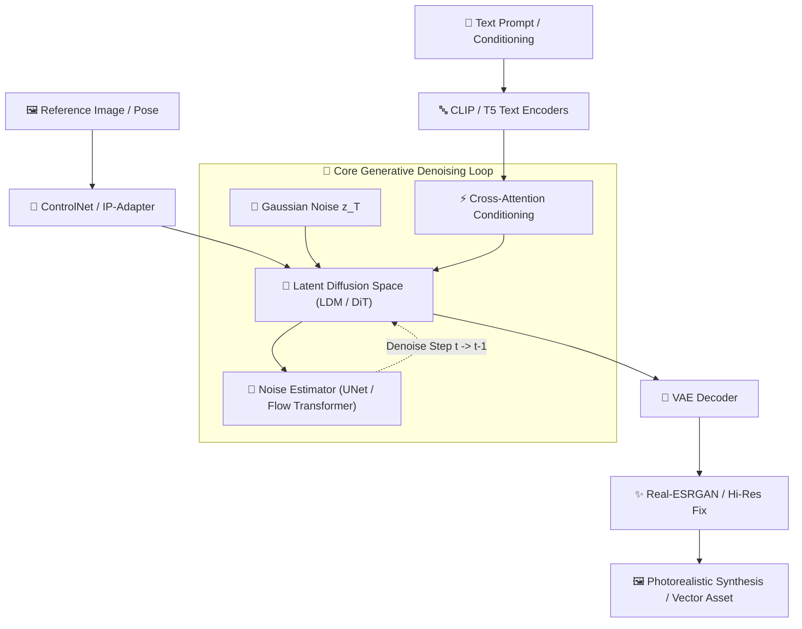

<p align="center">
  
</p>

# 🎨 Awesome Diffusion Models & Generative AI Ecosystem 🚀

<a href="https://github.com/ishandutta2007/Awesome-Awesome-Awesome"></a><a href="https://discord.gg/jc4xtF58Ve"></a>
[](https://github.com/ishandutta2007/Awesome-Diffusion-Models-Generative-AI/stargazers)
[](LICENSE)
[](https://github.com/ishandutta2007/Awesome-Diffusion-Models-Generative-AI/pulls)
[](https://github.com/ishandutta2007/Awesome-Diffusion-Models-Generative-AI/graphs/commit-activity)
[](#-saashosted-commercial-platforms)
<a href="https://github.com/ishandutta2007"></a>

> 🌟 **A definitive, battle-tested, curated index of Latent Diffusion Models (LDM), Diffusion Transformers (DiT), Generative AI platforms, Text-to-Image (T2I) synthesis suites, neural fine-tuning frameworks, and creative production pipelines.**

---

## 📑 Table of Contents

- [🔍 Sector Overview & Market Dynamics](#-sector-overview--market-dynamics)
- [🏢 SaaS / Hosted Commercial Platforms](#-saashosted-commercial-platforms)
- [💻 Open-Source GitHub Projects & Frameworks](#-open-source-github-projects--frameworks)
- [🧠 Technical Taxonomy & Core Architectures](#-technical-taxonomy--core-architectures)
- [🤝 How to Contribute](#-how-to-contribute)
- [💖 Support](#-support)
- [📈 Star History](#--star-history)
- [⚖️ Legal & Ethical Usage Disclaimer](#-legal--ethical-usage-disclaimer)

---

## 🔍 Sector Overview & Market Dynamics

The dedicated global **AI Image Generation software sector** is estimated to reach between **$525 million and $555 million in 2026** (expanding within a visual AI and generative digital content market exceeding **$11.2 billion**, and an overarching generative AI market surpassing **$100 billion**).

From an industrial organization perspective, the sector exhibits a distinct **barbell market structure**:
- **Highly Concentrated at the Foundation Layer:** The underlying compute-intensive foundation model infrastructure is an oligopoly dominated by well-capitalized tech titans and premier research labs (Adobe, OpenAI, Midjourney, Stability AI, Black Forest Labs) due to steep multi-million-dollar GPU cluster capital requirements and proprietary dataset moats.
- **Moderately to Highly Fragmented at the Application Layer:** Conversely, the downstream commercial application and workflow tooling ecosystem is intensely fragmented—hundreds of vertical SaaS tools, community fine-tunes, open-source user interfaces, and domain-specific creative plugins compete aggressively for individual creators, game studios, visual agencies, and enterprise marketing pipelines.

---

## 🏢 SaaS / Hosted Commercial Platforms

The following table benchmarks category-leading proprietary platforms. It includes verified starting pricing tiers, exact free tier / trial allowances, and estimated company market capitalization, valuation, or annual recurring revenue (ARR)—**sorted in descending order by company size**.

| 🏷️ Platform & Service | 💰 Company Size (Valuation / Market Cap / ARR) | 💳 Starting Tier Pricing | 🎁 Free Tier / Trial Limits | 🎯 Core Strengths & Primary Specialization |
| :--- | :--- | :--- | :--- | :--- |
| **[Adobe Firefly](https://www.adobe.com/products/firefly.html)** | **~$165+ Billion** Market Cap (Public: NASDAQ: ADBE; $21B+ ARR) | **$9.99 / month** (Firefly Standard plan with 2,000 generative credits/mo) | **25 generative credits / month** free forever (resets monthly; standard resolution, incorporates Adobe Content Credentials) | Enterprise-grade commercial safety; trained exclusively on licensed Adobe Stock and public domain assets with full enterprise indemnification. |
| **[DALL-E 3 (OpenAI)](https://openai.com/dall-e-3)** | **~$157 Billion** Valuation ($3.7B–$5B+ annualized run-rate) | **$0.040 / standard image** (1024×1024 via API) or **$20.00 / month** (ChatGPT Plus) | **2 to 3 image generations per 24 hours** free forever via ChatGPT Free (powered by GPT-4o multimodal engine) | Industry benchmark for prompt faithfulness, multi-character coherence, complex scene composition, and crisp in-image text typography. |
| **[Midjourney](https://www.midjourney.com/)** | **~$10 Billion** Est. Valuation (~$300M–$500M ARR; Bootstrapped & Profitable) | **$10.00 / month** (Basic Plan: ~200 fast GPU generations / 3.3 GPU hrs/mo) | **7-day free trial** with **20 lifetime trial generations** in the *niji·journey* mobile app (no web/Discord permanent free plan) | The undisputed benchmark for aesthetic nuance, photorealistic lighting, cinematic textures, painterly concept art, and high artistic dynamism. |
| **[Runway](https://runwayml.com/)** | **~$5.3 Billion** Valuation ($887M total capital raised; Series E) | **$12.00 / user / month** billed annually ($144/yr; or $15/mo monthly; 625 credits/mo) | **125 one-time initial credits** free forever (~25 image generations or 8s Gen-2/Gen-3 video), 5GB cloud storage, 3 video projects | End-to-end multimodal creative powerhouse; industry-leading text-to-video (Gen-3 Alpha), video-to-video, camera control, and generative visual suites. |
| **[Stability AI Platform](https://stability.ai/)** | **~$1.0 Billion** Valuation ($100M+ raised; Coatue / Lightspeed / Premji) | **$10.00 pay-as-you-go credit pack** (1,000 API credits; ~285 SD 3.5 Large calls at 3.5 credits / ~$0.035 each) | **25 free credits upon registration**; open weights free forever for commercial use under **$1,000,000 annual revenue** | Foundation model provider behind Stable Diffusion (SD 1.5, SDXL, SD 3.5 Large/Medium); versatile APIs with unmatched community extension support. |
| **[Ideogram](https://ideogram.ai/)** | **~$500 Million** Valuation ($80M Series A; Andreessen Horowitz) | **$7.00 / month** billed annually ($84/yr; or $8/mo monthly; 400 priority credits/mo) | **10 slow credits per week** free forever (produces up to 40 public images/week with standard queue priority) | SOTA text rendering, typography placement, graphic design layouts, brand signage, apparel prints, and vector-style poster compositions. |
| **[Leonardo AI](https://leonardo.ai/)** | **~$320 Million** Acquisition by Canva (Part of $40B Canva ecosystem) | **$10.00 / month** billed annually ($120/yr; or $12/mo monthly; 8,500 fast tokens/mo) | **150 fast tokens per day** free forever (renews every 24 hours; equivalent to ~15–20 high-res image generations daily) | Tailored game asset production, concept art engines, custom LoRA model training, real-time Canvas painting, and texture map generation. |
| **[Recraft AI](https://www.recraft.ai/)** | **~$150 Million** Valuation ($30M Series B; Accel / Khosla Ventures) | **$20.00 / month** billed annually ($240/yr; or $25/mo monthly; 1,000 credits/mo, or $10 API top-up) | **50 free credits every day** free forever (resets every 24 hours; public gallery generations for vector & raster outputs) | Native vector graphics (SVG), 3D icon sets, corporate brand style boards, and scalable infinite-resolution graphic design assets. |
| **[NightCafe Studio](https://nightcafe.studio/)** | **~$10 Million** ARR (Self-funded / Bootstrapped) | **$4.79 / month** billed quarterly ($14.37/qtr; or $5.99/mo monthly; 100 monthly credits) | **5 free credits daily upon login** + **2 bonus credits daily** for voting in daily challenge (**7 credits / day free forever**) | Multi-algorithm aggregation hub (SDXL, DALL-E 3, Flux), vibrant creator community challenges, social collaboration, and print-on-demand fulfillment. |
| **[Artbreeder](https://www.artbreeder.com/)** | **~$3 Million** ARR (Independent / Seed funded) | **$7.49 / month** billed annually ($89.99/yr; or $8.99/mo monthly; 100 credits/mo) | **10 initial credits upon signup** + **3 free credits / month forever**, plus unlimited low-res image breeding and mixer tools | Latent space genetic breeding, lineage exploration, character portrait morphing, collage synthesis, and collaborative generative art creation. |

---

## 💻 Open-Source GitHub Projects & Frameworks

The open-source generative AI movement provides self-hostable, transparent, and censorship-free alternatives to proprietary systems. Below are category-leading repositories—**sorted in descending order by GitHub Stars_Count**, featuring live social Stars_Badges linking directly to their respective stargazers pages.

### 🥇 1. [AUTOMATIC1111 / stable-diffusion-webui](https://github.com/AUTOMATIC1111/stable-diffusion-webui)
[](https://github.com/AUTOMATIC1111/stable-diffusion-webui/stargazers)
- **License:** AGPL-3.0
- **Focus:** The pioneering browser-based graphical user interface for Stable Diffusion.
- **Key Capabilities:** Provides comprehensive txt2img, img2img, inpainting, outpainting, textual inversion, LoRA management, prompt weighting, and an expansive ecosystem of thousands of community extensions.

### 🥈 2. [comfyanonymous / ComfyUI](https://github.com/comfyanonymous/ComfyUI)
[](https://github.com/comfyanonymous/ComfyUI/stargazers)
- **License:** GPL-3.0
- **Focus:** The premier node-based visual programming graph interface for generative diffusion pipelines.
- **Key Capabilities:** Modular visual computation graph allowing granular chaining of SD 1.5, SDXL, SD 3.5, and FLUX.1 models with ControlNet, IP-Adapter, LCM, FreeU, multi-pass upscaling, and video animation workflows with minimal VRAM overhead.

### 🥉 3. [CompVis / stable-diffusion](https://github.com/CompVis/stable-diffusion)
[](https://github.com/CompVis/stable-diffusion/stargazers)
- **License:** CreativeML Open RAIL-M
- **Focus:** The historic foundation repository for High-Resolution Image Synthesis with Latent Diffusion Models.
- **Key Capabilities:** Original reference implementation by Ludwig Maximilian University Munich (CompVis) & Runway, demonstrating cross-attention latent diffusion mechanisms that democratized generative computer vision worldwide.

### 4. [lllyasviel / Fooocus](https://github.com/lllyasviel/Fooocus)
[](https://github.com/lllyasviel/Fooocus/stargazers)
- **License:** GPL-3.0
- **Focus:** Minimalist, out-of-the-box local image generation interface marrying Midjourney's simplicity with Stable Diffusion's open power.
- **Key Capabilities:** Automated prompt expansion (via GPT-2 style engines), built-in dual-model refiner mechanisms, automated contrast adjustments, native inpainting brushes, and zero-configuration high-fidelity rendering.

### 5. [xinntao / Real-ESRGAN](https://github.com/xinntao/Real-ESRGAN)
[](https://github.com/xinntao/Real-ESRGAN/stargazers)
- **License:** BSD-3-Clause
- **Focus:** Practical state-of-the-art super-resolution and image restoration algorithms.
- **Key Capabilities:** Restores low-resolution synthesized images, eliminates latent diffusion compression artifacts, sharpens textures, and scales outputs to 4K/8K resolution with realistic details.

### 6. [huggingface / diffusers](https://github.com/huggingface/diffusers)
[](https://github.com/huggingface/diffusers/stargazers)
- **License:** Apache-2.0
- **Focus:** The industry-standard PyTorch library for state-of-the-art diffusion models for image, audio, and video generation.
- **Key Capabilities:** Unified pipeline API supporting SD 1.5/2.1, SDXL, SD 3.5, FLUX.1, Kandinsky, PixArt-α, DeepFloyd IF, and modern schedulers (DDIM, DPMSolverMultistep, EulerDiscrete) with FlashAttention and torch.compile acceleration.

### 7. [lllyasviel / ControlNet](https://github.com/lllyasviel/ControlNet)
[](https://github.com/lllyasviel/ControlNet/stargazers)
- **License:** Apache-2.0
- **Focus:** Groundbreaking neural network architecture adding spatial conditioning controls to large diffusion models.
- **Key Capabilities:** Enables deterministic geometric composition through Canny edge maps, depth estimation, OpenPose skeletal poses, semantic segmentation, surface normals, and scribble guidance.

### 8. [invoke-ai / InvokeAI](https://github.com/invoke-ai/InvokeAI)
[](https://github.com/invoke-ai/InvokeAI/stargazers)
- **License:** Apache-2.0
- **Focus:** Professional visual creation toolkit engineered for production artists and studio teams.
- **Key Capabilities:** Unified Infinite Canvas for non-destructive inpainting, regional prompting, outpainting, Control Layers, custom asset boards, enterprise workflow collaboration, and clean local deployment.

### 9. [Stability-AI / generative-models](https://github.com/Stability-AI/generative-models)
[](https://github.com/Stability-AI/generative-models/stargazers)
- **License:** Stability AI Community License / MIT
- **Focus:** Official Stability AI research codebase powering SDXL, SDXL Turbo, SV3D, and Stable Video Diffusion (SVD).
- **Key Capabilities:** Production training, inference, and fine-tuning scripts for high-resolution 1024×1024 latent models, video diffusion, and multi-view 3D synthesis.

### 10. [black-forest-labs / flux](https://github.com/black-forest-labs/flux)
[](https://github.com/black-forest-labs/flux/stargazers)
- **License:** Apache-2.0 (schnell) / Non-Commercial (dev)
- **Focus:** State-of-the-art 12-billion parameter rectified flow transformer (DiT) models created by the original Stable Diffusion inventors.
- **Key Capabilities:** Exceptional prompt comprehension, photorealistic anatomy rendering, native typography synthesis, rotary position embeddings (RoPE), and competitive quality exceeding proprietary giants.

### 11. [Sanster / IOPaint](https://github.com/Sanster/IOPaint)
[](https://github.com/Sanster/IOPaint/stargazers)
- **License:** Apache-2.0
- **Focus:** Production-grade image inpainting and outpainting tool powered by state-of-the-art AI models.
- **Key Capabilities:** Completely offline web UI supporting SD inpainting, LaMa, MAT, Manga, Real-ESRGAN, and brush-based object removal, watermark erasure, and scene expansion.

### 12. [KwaiVGI / LivePortrait](https://github.com/KwaiVGI/LivePortrait)
[](https://github.com/KwaiVGI/LivePortrait/stargazers)
- **License:** MIT
- **Focus:** High-efficiency, controllable portrait video animation framework from single reference images.
- **Key Capabilities:** Real-time head pose retargeting, facial expression synthesis, eye gaze tracking, and lip-syncing without requiring heavy 3DMM fitting.

### 13. [CompVis / latent-diffusion](https://github.com/CompVis/latent-diffusion)
[](https://github.com/CompVis/latent-diffusion/stargazers)
- **License:** MIT
- **Focus:** The seminal research codebase from CVPR 2022 detailing high-resolution image synthesis in latent space.
- **Key Capabilities:** Establishes the perceptual image compression stage (Autoencoder VQ-GAN / KL) coupled with latent denoising score matching.

### 14. [lllyasviel / stable-diffusion-webui-forge](https://github.com/lllyasviel/stable-diffusion-webui-forge)
[](https://github.com/lllyasviel/stable-diffusion-webui-forge/stargazers)
- **License:** AGPL-3.0
- **Focus:** High-performance, memory-optimized fork of AUTOMATIC1111 WebUI.
- **Key Capabilities:** Re-engineered backend with PyTorch native optimizations; slashes VRAM usage by up to 50%, boosts inference speed up to 75%, and provides seamless out-of-the-box FLUX.1 and SDXL support.

### 15. [Tencent / HunyuanVideo](https://github.com/Tencent/HunyuanVideo)
[](https://github.com/Tencent/HunyuanVideo/stargazers)
- **License:** Apache-2.0
- **Focus:** Tencent's 13-billion parameter open-source foundation video generation model.
- **Key Capabilities:** High-definition text-to-video synthesis with dual-stream diffusion transformer architectures, long-term temporal coherence, and bilingual (English/Chinese) prompt support.

### 16. [bmaltais / kohya_ss](https://github.com/bmaltais/kohya_ss)
[](https://github.com/bmaltais/kohya_ss/stargazers)
- **License:** Apache-2.0
- **Focus:** The de-facto standard graphical training interface for LoRA, LyCORIS, Dreambooth, and full model fine-tuning.
- **Key Capabilities:** Granular hyperparameters for optimizer selection (AdamW, Adafactor, Prodigy), aspect ratio bucketing, learning rate schedulers, and caption preprocessing for SD 1.5, SDXL, and modern DiTs.

### 17. [guoyww / AnimateDiff](https://github.com/guoyww/AnimateDiff)
[](https://github.com/guoyww/AnimateDiff/stargazers)
- **License:** Apache-2.0
- **Focus:** Plug-and-play temporal motion module for animating personalized text-to-image diffusion models.
- **Key Capabilities:** Injects motion attention layers across temporal dimensions without retraining base 2D checkpoint weights, animating community anime and realistic checkpoints seamlessly.

### 18. [Acly / krita-ai-diffusion](https://github.com/Acly/krita-ai-diffusion)
[](https://github.com/Acly/krita-ai-diffusion/stargazers)
- **License:** GPL-3.0
- **Focus:** Professional AI painting plugin integrating ComfyUI directly inside Krita.
- **Key Capabilities:** Live interactive canvas painting, layer-aware inpainting, sketch-to-image synthesis, upscaling, and native digital artist workflow integration.

### 19. [lucidrains / denoising-diffusion-pytorch](https://github.com/lucidrains/denoising-diffusion-pytorch)
[](https://github.com/lucidrains/denoising-diffusion-pytorch/stargazers)
- **License:** MIT
- **Focus:** Elegant, minimal, and readable PyTorch implementation of Denoising Diffusion Probabilistic Models (DDPM).
- **Key Capabilities:** Idiomatic reference implementation covering Gaussian diffusion, 1D/2D U-Nets, linear and cosine beta schedules, and classifier-free guidance.

### 20. [openai / guided-diffusion](https://github.com/openai/guided-diffusion)
[](https://github.com/openai/guided-diffusion/stargazers)
- **License:** MIT
- **Focus:** Seminal research codebase for "Diffusion Models Beat GANs on Image Synthesis" (NeurIPS 2021).
- **Key Capabilities:** Classifier guidance and improved noise scheduling that established diffusion models as the new reigning generative vision paradigm over generative adversarial networks.

### 21. [tencent-ailab / IP-Adapter](https://github.com/tencent-ailab/IP-Adapter)
[](https://github.com/tencent-ailab/IP-Adapter/stargazers)
- **License:** Apache-2.0
- **Focus:** Image Prompt Adapter for pretrained text-to-image diffusion models.
- **Key Capabilities:** Decoupled cross-attention mechanism enabling image prompts (style reference, character face consistency, structural transfer) without modifying base diffusion weights.

### 22. [Stability-AI / StableSwarmUI](https://github.com/Stability-AI/StableSwarmUI)
[](https://github.com/Stability-AI/StableSwarmUI/stargazers)
- **License:** MIT
- **Focus:** Official Stability AI enterprise-grade modular web user interface.
- **Key Capabilities:** High-throughput cluster generation with ComfyUI backend integration, batch dispatching, grid generation, multi-GPU load balancing, and cross-platform installation.

---

## 🧠 Technical Taxonomy & Core Architectures



### 🔬 Architecture Comparison

| 🧬 Model Family | 📐 Core Backbone | ⚡ Attention Mechanism | 🏎️ Typical Sampling Steps | 💻 Target Hardware |
| :--- | :--- | :--- | :--- | :--- |
| **Stable Diffusion 1.5** | ResNet-based U-Net | Cross-Attention with CLIP ViT-L/14 | 20–30 (Euler/DPM++) | 4GB–8GB VRAM |
| **Stable Diffusion XL** | Scaled U-Net (2.6B params) | Dual Encoders (OpenCLIP ViT-bigG + CLIP ViT-L) | 25–40 (Euler a/DPM++ 2M SDE) | 8GB–12GB VRAM |
| **SD 3.5 Large / Turbo** | Multimodal DiT (MMDiT) | Separate weights for image & text streams | 4–8 (Turbo) / 28–40 (Large) | 12GB–16GB VRAM |
| **FLUX.1 [schnell/dev]** | 12B Rectified Flow Transformer | Joint attention over concatenated sequences | 4 (schnell) / 20–50 (dev) | 12GB–24GB VRAM |
| **ControlNet Adapters** | Locked model copy + trainable residuals | Zero-convolutions with feature injection | Identical to base checkpoint | +1GB–2GB VRAM |

---

## 🤝 How to Contribute

We welcome additions, corrections, and benchmark submissions from researchers and engineers:

1. **🍴 Fork this repository** to your GitHub account.
2. **🌿 Create a feature branch:**
   ```bash
   git checkout -b feature/add-new-diffusion-tool
   ```
3. **✏️ Update `README.md`:**
   - For **SaaS platforms**, update the markdown table with specific starting tier pricing and exact free tier/trial limits.
   - For **Open-Source projects**, add the social Stars_Badge (`style=social&color=white`) linking to its stargazers page, and maintain strict descending star-count sorting.
4. **💬 Commit your changes:**
   ```bash
   git commit -m "feat: add [Tool Name] with pricing and benchmarks"
   ```
5. **🚀 Push and submit a Pull Request:** Open a PR against `main` with a concise explanation.

---

## 💖 Support

Thank you for exploring and utilizing the **Awesome Diffusion Models & Generative AI** directory! If this ecosystem guide has helped accelerate your projects, research, or creative pipelines, please consider supporting the project:

- ⭐ **Star this repository** on GitHub to help others discover it.
- 🍴 **Fork the repo** to benchmark models or customize workflows for your team.
- 📢 **Share with colleagues and community members** across Twitter/X, LinkedIn, Discord, and Reddit.
- ☕ **Support continuous development and curation** by sponsoring or buying a coffee via the [GitHub Sponsors Dashboard](https://github.com/sponsors/ishandutta2007):

<p align="center">
  <a href="https://github.com/sponsors/ishandutta2007">
    
  </a>
</p>

---

##  Star History
[](https://star-history.dera.page/#ishandutta2007/Awesome-Diffusion-Models-Generative-AI&type=date&legend=top-left)

---

## ⚖️ Legal & Ethical Usage Disclaimer

- 📌 **Content Provenance & Transparency:** Generative AI media must comply with intellectual property laws, publicity rights, and platform terms. Compliance frameworks (such as the EU Artificial Intelligence Act Article 50 and C2PA Content Credentials) mandate clear provenance tracking.
- 🛡️ **Commercial Indemnification:** Adobe Firefly provides formal commercial indemnification as its models train on licensed Adobe Stock and public domain media. Open-source models trained on public web scrapes (e.g., LAION subsets) require careful copyright vetting for enterprise commercial deployment.
- 📜 **Licensing Precision:**
  - **Stability AI Community License:** Free for commercial use up to $1,000,000 in annual revenue; above this threshold an Enterprise License is required.
  - **FLUX.1 [schnell]:** Released under Apache 2.0 (permissive commercial use). **FLUX.1 [dev]** is non-commercial only.
  - **ComfyUI / AUTOMATIC1111:** Released under GPL-3.0 / AGPL-3.0 copyleft licenses.
- 🔒 **Local Deployment & Compute:** Self-hosted open-source pipelines are recommended to run with at least 12GB–16GB VRAM for high-resolution SDXL and DiT architectures (e.g., NVIDIA RTX 3060 12GB, RTX 4070+, or A10G/A100 cloud instances).

---

<p align="center">
  <b>⭐ Star this repository if you find it helpful for your generative AI pipelines! ⭐</b>
</p>
